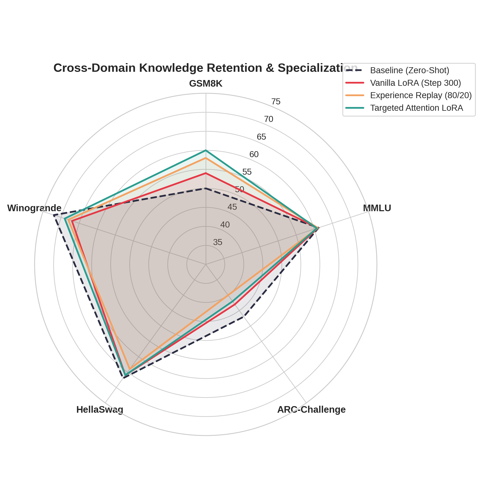
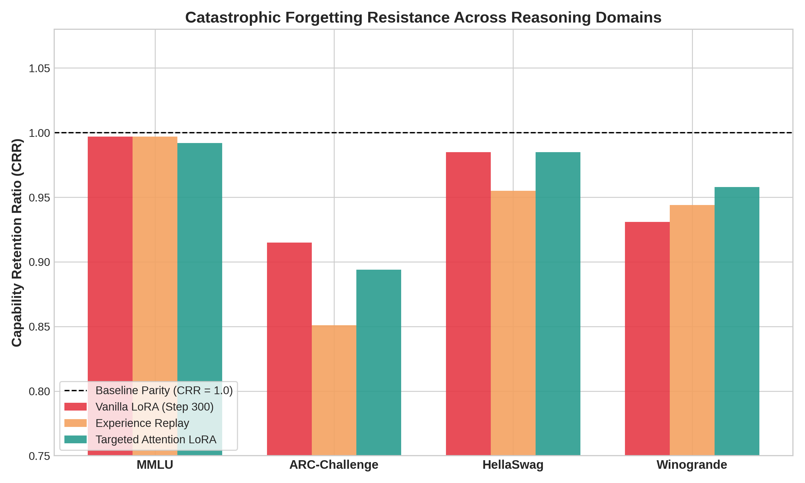

# Empirical Investigation of Catastrophic Forgetting Dynamics in Small Language Models (SLMs)

[](https://www.python.org/downloads/)
[](https://pytorch.org/)
[](https://opensource.org/licenses/MIT)
[](https://huggingface.co/Qwen/Qwen2.5-1.5B)

An empirical study evaluating domain specialization trade-offs and catastrophic forgetting dynamics in **Qwen2.5-1.5B** during mathematical adaptation (**GSM8K**), benchmarked across multi-domain reasoning axes (**MMLU**, **ARC-Challenge**, **HellaSwag**, **Winogrande**).

---

## 1. Experimental Overview

* **Base Architecture**: `Qwen/Qwen2.5-1.5B` ($d = 1536$, 28 layers, 12 attention heads)
* **Optimization Setup**: Low-Rank Adaptation (LoRA), $r=16$, $\alpha=16$, dropout $0.0$, AdamW 8-bit, cosine learning rate scheduler ($2 \times 10^{-4}$), effective batch size 8.
* **Evaluation Framework**: `lm-evaluation-harness` across 5 representative tasks.
* **Mathematical Formulations**:
  * **Absolute Delta ($\Delta_{\text{abs}}$)**:
    $$\Delta_{\text{abs}} = \text{Acc}_{\text{eval}} - \text{Acc}_{\text{baseline}}$$
  * **Capability Retention Ratio (CRR)**:
    $$\text{CRR} = \frac{\text{Acc}_{\text{eval}}}{\text{Acc}_{\text{baseline}}}$$

---

## 2. Master Evaluation Results

| Benchmark Axis | Task ID | Baseline (Zero-Shot) | Vanilla (Step 100) | Vanilla (Step 300) | Experience Replay (80/20) | Targeted Attention LoRA |
| :--- | :--- | :---: | :---: | :---: | :---: | :---: |
| **GSM8K (Target - Math)** | `gsm8k` | **50.00%** | 64.00% | 54.00% | **58.00%** | 56.00% |
| **MMLU (Broad Academia)** | `mmlu` | **61.19%** | 60.50% | 60.98% | **61.00%** | 61.15% |
| **ARC-C (Multi-Hop Science)** | `arc_challenge` | **47.00%** | 42.00% | 43.00% | **40.00%** | **46.00%** |
| **HellaSwag (Commonsense)** | `hellaswag` | **67.00%** | 67.00% | 66.00% | **64.00%** | **67.00%** |
| **Winogrande (Language Logic)** | `winogrande` | **72.00%** | 71.00% | 67.00% | **68.00%** | **71.00%** |

---

## 3. Key Findings

### A. Non-Linear Forgetting Dynamics (Vanilla LoRA)
* **Early Peak vs. Representational Drift**: Target task adaptation (GSM8K) peaks early at Step 100 (+14.00%) before regressing due to format over-specialization by Step 300 (+4.00% net).
* **Asymmetric Decay**: Multi-hop scientific reasoning (ARC-Challenge) collapses immediately ($\text{CRR} = 0.894$), while core linguistic disambiguation (Winogrande) exhibits delayed degradation, declining between Step 100 and Step 300.

### B. The Replay Capacity Interference Penalty (Experience Replay)
* An 80/20 data mixture (GSM8K + Alpaca) stabilizes target math performance at Step 300 (+4.00% recovery over Vanilla).
* However, in parameter-efficient configurations ($r=16$), multi-task data sharing causes **gradient contention** within the rank-constrained subspace, accelerating forgetting in complex science reasoning (ARC-Challenge drops to 40.00%).

### C. Parametric Memory Isolation (Targeted Attention LoRA)
* Freezing feed-forward MLP projections (`gate_proj`, `up_proj`, `down_proj`) cuts trainable parameters by **~55%** (~18.4M $\to$ ~8.2M).
* Restricting updates strictly to attention routing matrices (`q, k, v, o`) shields associative factual memory banks while allowing the model to acquire procedural mathematical reasoning.

---

## 4. Visualizations

| Multi-Task Performance Footprint | Retention Ratios (CRR vs. Baseline Parity) |
|:---:|:---:|
|  |  |

---

## 5. Repository Structure

```text
slm-catastrophic-forgetting/
├── README.md                           # Empirical study report & synthesis
├── figures/                            # Publication-grade analytical charts
│   ├── cross_domain_radar.png
│   └── crr_retention_comparison.png
├── results_summary/                    # Tabular benchmark summaries
│   ├── step0_baseline.csv
│   ├── layer1_dynamics.csv
│   ├── layer2_mitigation.csv
│   ├── layer3_mitigation.csv
│   └── master_study_results.csv
└── scripts/                            # Reproducible pipelines
    ├── train_layer1_lora.py
    ├── parse_layer1.py
    ├── train_layer2_replay.py
    ├── parse_layer2.py
    ├── train_layer3_targeted.py
    └── parse_layer3.py
